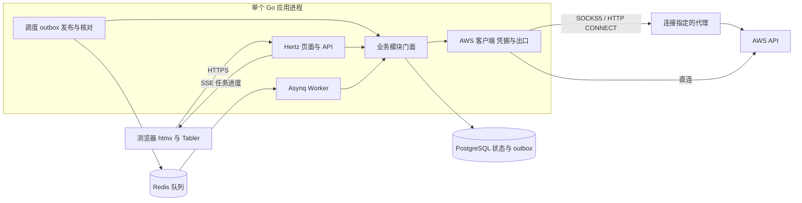

# 架构

AWS Panel 是单进程的模块化单体。`run` 命令启动一个 Go 进程，在其中运行 Hertz HTTP 服务、Asynq Worker、调度器、outbox 发布器与任务维护循环。`internal/app` 是唯一的组装根，只有 CLI 调用它；迁移和维护命令使用同一个二进制。



API 负责鉴权、查询、输入校验、预览、任务提交和事件读取；Worker 执行任务步骤、核对云端结果、刷新快照。轻量只读查询（连接验证、创建目录）可以同步调用 AWS；修改云端资源的操作一律进入任务系统。PostgreSQL 是业务数据与任务状态的唯一权威来源；Redis 承担队列、展示缓存与登录限流。

## 模块

| 模块 | 职责与拥有的数据 |
| --- | --- |
| identity | 成员、会话、团队角色、账号授权 |
| accounts | AWS 账号、连接、代理、秘密存储、凭据生命周期与验证 |
| operations | 计划、任务、步骤、租约、尝试记录、outbox、进度事件、云端发送记录与目标锁 |
| inventory | 资源快照、同步范围与定时同步 |
| dashboard | 按授权账号聚合资源与配额的快照 |
| regions | 区域启用 |
| lightsail | Lightsail 创建与创建记录 |
| compute | EC2 / Wavelength 实例、网络准备 |
| addresses | 实例固定 IP 的分配、绑定、更换与释放 |
| quotas | 适用配额与用量查询 |
| platform | 系统状态、设置与审计 |

每个模块的结构相同：根包提供 `Service` 门面与 `New(deps)`；`contract` 放命令、查询和返回值；`entity` 放持久化实体；`internal` 放业务实现、仓储（`repo`）与 AWS 适配（`awsapi`）；`transport/http` 放本模块的 handler。Go 的 internal 规则阻止其他模块导入这些实现。

- handler 只做参数绑定、校验、门面调用与响应转换；`internal/transport/http/routes` 只组合路由、中间件与 handler。业务代码不接收 Hertz 请求上下文或 Asynq 任务。
- 依赖在消费者一侧声明为窄接口，由 `internal/app` 注入。`contract` 包之间不互相导入。
- 每张业务表只有一个属主模块；模块只访问自己的仓储，不做跨模块 JOIN。审计追加是唯一可以与业务写入同事务提交的跨模块能力。
- AWS SDK 调用不在数据库事务或持锁期间进行，公开接口不暴露 SDK 类型。
- `internal/arch` 中的测试检查组装根、模块、handler、任务入口与仓储属主的依赖方向。

## 凭据与出口

- 秘密以 AES-256-GCM 加密，密文带密钥 ID、随机 nonce，并用关联数据绑定所属记录。主密钥位于外部文件，不进入数据库、镜像或仓库。读取接口只返回脱敏信息，任务、事件、审计和日志只保存秘密引用。
- 每个连接和配置版本拥有独立的 `http.Client` 与 Transport，并显式注入 `aws.Config`；不加载宿主机的共享凭据文件或环境凭据，不使用 `ProxyFromEnvironment`，也不修改全局代理变量或 `DefaultTransport`。
- SOCKS5 使用 `golang.org/x/net/proxy` 的 ContextDialer；HTTP 代理使用 CONNECT。拨号、握手、TLS 与总请求时间都有上限。代理失败从不回退直连。
- 每次发送请求（包括 SDK 重试与 STS 刷新）前重新检查成员权限、账号 / 连接 / 代理的状态与版本，以及任务租约。配置变化后旧客户端立即失效。
- AWS 请求按物理账号、区域和服务共享进程内速率与并发预算。

## 任务执行

一个操作注册稳定的标识、输入与执行器版本，并实现四个阶段：

| 阶段 | 职责 |
| --- | --- |
| Validate | 强类型校验参数与目标范围 |
| Plan | 只读检查现状，生成目标与有序步骤 |
| Execute | 执行当前步骤，保存请求标识、资源引用与结果 |
| Reconcile | 只读查询云端状态，解决超时或重启后的不确定结果 |

从提交到完成：

1. API 校验身份、授权与输入，生成有时效的计划（目标、预计变更、参数摘要）。
2. 提交时复核授权与计划，在同一事务中保存任务、目标、步骤、初始事件、outbox 记录与审计。
3. 发布器在事务外把 outbox 投递到 Asynq；Redis 不可用时任务保持待投递。
4. Worker 收到只含引用的消息，在短事务中取得步骤租约，再在事务外调用执行器。
5. 结果、进度事件与下一次唤醒在一个事务中保存；等待云端完成时记录下次检查时间并释放 Worker。
6. 浏览器通过 SSE 读取持久化事件，断线后用 `Last-Event-ID` 补读。

Asynq 只提供至少一次投递，因此重复副作用由以下机制共同控制：提交幂等键；首次调用前保存的 AWS 幂等令牌；不支持令牌时的发送记录（`operation_effects`）、归属标签与操作历史核对；按目标键的数据库互斥锁（`operation_target_locks`）；带递增执行代号的租约，接管者必须先 Reconcile。维护循环扫描到期、未完成且无有效租约的步骤，补投丢失的消息。

任务固定执行器与输入版本；部署后缺少兼容执行器的任务暂停为“需要处理”，不会静默改用新逻辑。

## 数据

| 属主 | 主要表 |
| --- | --- |
| identity | members、sessions、account_grants |
| accounts | aws_accounts、connections、proxy_profiles、secrets |
| operations | plans、jobs、job_items、job_steps、job_attempts、job_events、operations_outbox、operation_effects、operation_target_locks、operations_diagnostic_effects |
| inventory | inventory_scopes、inventory_runs、resource_snapshots、inventory_schedules |
| dashboard | dashboard_snapshots、dashboard_runs |
| lightsail | lightsail_creations |
| platform | platform_settings、platform_heartbeats、audit_events |

迁移位于 `internal/app/migration/schema`，由 golang-migrate 执行嵌入的 PostgreSQL SQL，只提供向上迁移。核心查询字段使用普通列与约束，服务相关的扩展详情使用带版本的 JSONB。AWS 是资源实际状态的来源，数据库保存观测快照与任务结果；同步失败或权限不足不视为资源被删除。

## 时间与时区

全系统固定使用北京时间（Asia/Shanghai）：

- 进程在初始化日志、连接池和后台服务前设置 `time.Local`，并嵌入 `time/tzdata`；时区加载失败则拒绝启动。
- 每个 PostgreSQL 连接设置会话 `TimeZone`；时刻列使用 `timestamptz`。
- API 时间为带偏移的 RFC 3339（`+08:00`）；界面和日志统一按北京时间格式化。
- 定时与日历统计按北京时间计算；租约与期限按实际时刻比较，不手动加减八小时。

## HTTP 与页面

- JSON API 位于 `/api/v1`，长操作返回 202 与任务位置。错误响应包含稳定错误码、可读信息与 `request_id`。
- 契约以模块 `contract` 中的 Go DTO 与 handler 注释为来源，由 Swaggo 生成 `api/generated/swagger.json`，不手工修改。
- 页面与 HTML 片段由各模块 handler 调用同一个门面后渲染。模板位于 `web/templates`，静态资源位于 `web/static`，通过 `go:embed` 打包；htmx 负责局部更新，少量交互使用原生 JavaScript。
- 会话为可撤销的服务端会话，写请求校验同源与 CSRF。`HX-Request` 只决定响应形态，不作为身份依据；未登录的 htmx 请求通过 `HX-Redirect` 跳转整页。
- 模板默认转义，云端名称、错误和用户输入不会作为 HTML 输出；htmx 的 eval 与脚本执行已关闭。

## 目录

```text
main.go
cmd/                      Cobra 命令：run、migrate、admin、vault、healthcheck、version
internal/
  app/                    组装根、启动检查、调度器、迁移、运行状态
  auth/                   会话上下文、密码、令牌、登录限流、主密钥环
  config/                 严格 YAML 与环境变量覆盖
  infra/                  AWS 客户端与代理、PostgreSQL、任务队列、展示缓存、时钟
  module/<name>/          业务模块
  repository/             仓储契约与作用域事务
  transport/http/         路由、中间件、安全策略、视图辅助
  transport/task/         Asynq 发布与消费入口
  arch/                   依赖方向测试
pkg/                      响应封装、日志、追踪
web/                      模板与静态资源
api/generated/            Swagger
deploy/                   Dockerfile、Compose 与数据库初始化脚本
scripts/                  备份恢复、冒烟测试、资源校验与接口生成
tests/                    集成测试与端到端检查
```
