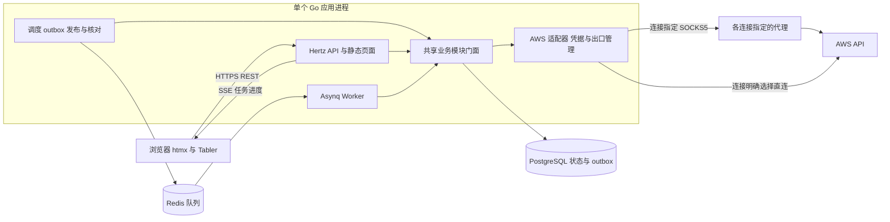

# AWS Panel 架构与工程规划

更新日期：2026-11-02。状态：架构基线与工程骨架。本文包含后续能力的目标设计；当前已实现范围及运行方法见 [开发与运行](development.md)。

## 项目定位

AWS Panel 是面向小团队的自托管 AWS 管理工具。成员通过自己的面板账号使用获授权的 AWS 账号，操作结果以资源状态、任务进度和审计记录呈现。

本次确定项目的基础结构与工程约定。具体 AWS 服务操作、网络模板、实例初始化内容、功能优先级和视觉风格留待后续设计。

已确定的使用场景是小团队内部使用和多 AWS 账号管理，采用单进程应用、Go template + htmx + Tabler、北京时间（Asia/Shanghai）和唯一业务数据库 PostgreSQL，并支持为不同账号凭据配置独立 SOCKS5 出口。以下其余技术栈与模块划分是本设计的建议基线；首版按单个部署服务一个团队组织数据。

后端参考 PPanel 当前代码中的模块门面、嵌套 internal 隔离、作用域事务、Hertz 接入和 Asynq 任务链路。具体来源与采用范围见 [PPanel 后端参考与取舍](ppanel-reference.md)。

## 整体架构

采用单进程的模块化单体。Cobra 的 run 命令启动一个常驻 Go 进程，在其中运行 Hertz API、Asynq Worker、调度器、outbox 发布器和核对服务。internal/app 是唯一应用组装根，只有 CLI 调用它，各接入层只接收所需门面。迁移和维护命令使用同一二进制按需执行。



API 负责登录鉴权、查询、输入校验、任务提交和事件读取。Worker 负责执行任务、查询云端执行结果和刷新资源快照。只读的连接验证或轻量查询可以同步调用 AWS，长时间查询进入任务系统；会修改云端资源的操作统一进入任务系统。

Asynq 使用 Redis 负责消息投递、消费并发、延迟执行和基础重试，PostgreSQL 保存业务任务、步骤、事件和待发布消息。首版部署组件为一个应用服务、PostgreSQL 和 Redis。单进程指应用运行方式，数据库和队列仍是独立服务；队列消息的完成或失败不直接等同于 AWS 业务任务的完成或失败。

API 与后台服务通过各自的 goroutine 并发运行，共享依赖和配置快照。任务执行使用有上限的 Worker 池，提交任务后 HTTP 请求即可返回。限制后台并发、数据库连接占用及请求耗时，为 API 查询和状态写入保留容量；页面请求的 context 不控制持久化任务的生命周期。

## 技术选择

| 层次 | 建议选择 | 用途 |
| --- | --- | --- |
| Web | Go html/template | 服务端渲染完整页面和 HTML 片段 |
| UI | Tabler | 管理界面的布局、表格、表单与反馈 |
| 页面交互 | htmx、少量原生 JavaScript | 表单提交、筛选、局部刷新与状态更新 |
| HTTP | CloudWeGo Hertz | 原生 handler、路由分组、中间件、SSE |
| AWS | AWS SDK for Go v2 | 服务客户端、签名、临时凭据与基础重试 |
| AWS 出口 | 独立 net/http.Client 与 Transport | 连接级 SOCKS5、超时、连接池和 TLS 校验 |
| 存储 | 仅 PostgreSQL、GORM | 模块仓储与作用域事务；复杂查询使用 PostgreSQL SQL |
| 迁移 | golang-migrate、嵌入式 SQL | 有版本的数据库结构迁移 |
| 队列 | Asynq、Redis | 工作投递、延迟任务、重试与消费并发 |
| Redis 客户端 | go-redis/v9 | 按需缓存、限流和运行状态通知 |
| CLI 与配置 | Cobra、YAML | run 启动服务组，迁移与维护按需执行 |
| 校验 | go-playground/validator/v10 | HTTP 输入结构校验，业务约束由模块校验 |
| 契约 | 模块 contract、Swaggo | 从 Go DTO 和 handler 注释生成 Swagger 文档 |
| 日志与追踪 | log/slog、OpenTelemetry | 脱敏结构化日志，贯通 HTTP、队列和 AWS 请求 |
| 实时进度 | SSE | 单向任务事件与断线重连 |
| 部署 | Docker Compose | 小团队自托管和本地集成环境 |

依赖通过 Go Modules 和静态资源清单锁定。htmx 与 Tabler 文件及许可证随仓库维护，清单保存来源、版本与 SHA-256；构建和运行不依赖外部 CDN，也不需要 Node.js 构建链。PPanel 的版本号作为对照，不直接视为本项目已验证的依赖组合。

数据库只使用 PostgreSQL，这是项目约束，不是首版的临时范围。不提供数据库类型切换、其他数据库驱动、多方言迁移或兼容层；仓储接口用于模块隔离。开发、集成测试和生产使用同一种数据库，数据库测试也不使用 SQLite 替代 PostgreSQL。

GORM PostgreSQL 驱动使用 pgx，业务不再同时维护一套独立 pgx 仓储。golang-migrate 执行一套按版本维护的 PostgreSQL SQL，不用 GORM AutoMigrate 替代生产迁移。迁移通过独立命令执行，服务启动只检查版本兼容性。Redis 继续承担队列、缓存和限流，业务数据与任务状态以 PostgreSQL 为准。

## 模块与依赖边界

| 模块 | 拥有的数据与职责 |
| --- | --- |
| identity | 成员、登录会话、团队级角色、账号授权 |
| accounts | AWS 账号、连接、代理配置、秘密存储、凭据生命周期、验证与可用性 |
| operations | 操作注册、计划、任务、步骤、租约、执行记录、outbox 与进度事件 |
| inventory | 云端资源快照、同步时间与刷新状态 |
| platform | 系统设置、审计读取与事务内追加审计的公共能力 |
| AWS 服务模块 | 各服务的领域输入、资源映射、操作步骤和结果核对 |

模块按数据和事务归属划分：凭据生命周期归 accounts，任务执行归 operations，审计与设置归 platform。platform 作为共享内核不依赖其他业务模块。模块内部再按需要拆包，避免每个辅助能力都变成必须跨事务协作的独立模块。

每个模块沿用 PPanel 的结构：根包提供 Service 门面和 New(deps)，contract 放命令、查询和返回值，entity 放持久化实体，internal 放业务实现与仓储，transport/http 放本模块的 Hertz handler。Go 编译器限制其他模块导入其嵌套 internal 包。

HTTP handler 只做参数绑定、结构校验、门面调用与响应转换；顶层 transport/http/routes 只组合 URL、中间件与 handler。任务 handler 只解码引用并调用模块。业务不接收 Hertz RequestContext、Asynq Task 或完整 Application，使用 context.Context 和业务参数。

依赖在消费者侧声明为窄接口，由 internal/app 注入。模块之间通过门面、只读快照或集成事件协作；contract 不互相导入，不恢复中央 DTO 包。跨模块协议采用属主导出的稳定类型或消费者所需快照，经组装适配器转换，不直接传递其他模块的 ORM 实体。

每张业务表只有一个属主；模块只访问自己的仓储和作用域事务，不开放完整 Store 或通用 DB 逃生口，不进行跨模块 JOIN。跨模块业务写入采用各自事务、幂等调用和必要的 outbox/inbox，不使用统一跨域事务。只有审计追加可通过明确的事务适配器与业务写入原子提交，该能力不提供跨域业务读写。

internal/repository 按模块声明仓储契约、作用域事务和构造能力；实现仍在所属模块 internal/repo。中立的连接与审计追加契约置于 repository/kernel，使 platform 不依赖聚合业务仓储。AWS SDK 调用不得处于数据库事务或持锁期间，公开 HTTP 契约不暴露 SDK 类型。

AWS 服务模块按实际功能逐步建立；不预先生成全部 AWS 服务目录，也不建立跨云抽象或运行时插件系统。

internal/arch 用测试验证组装根、模块、handler、任务入口、共享包及仓储属主的依赖方向。它检查实际 import 与能力使用；复杂 SQL 的表归属仍需评审与集成验证。

## 身份 账号与凭据

### 三类身份

- 成员是登录面板的人，拥有团队级角色及 AWS 账号范围内的授权。
- AWS 账号是云端资源所属的身份，以 partition 和 AWS account ID 唯一标识。
- 连接是访问该账号的方法，包括凭据引用、目标角色、来源身份、出口模式、代理引用、状态和配置版本。

AWS 账号与连接分开存储：同一个 AWS 账号可以有多种连接方式，资源不会因为更换凭据而重复建立账号记录。任务明确绑定连接和目标账号；执行前验证二者匹配，连接失败时不会自动切换到权限更大的连接。

数据库包含 partition 字段，用于区分 AWS 分区。首批支持哪些分区由后续功能范围确定，字段存在不代表相关端点和服务已经得到验证。

连接验证分别记录身份是否有效、目标账号是否匹配以及具体能力检查结果。身份查询成功不能代表所有操作都有权限；能力结果携带检查时间，并在实际执行时重新处理 AWS 的权限判定。

### 授权规则

初版设管理员、操作员、只读成员三类角色，并按 AWS 账号授权。管理员管理成员、连接与授权；其他角色的资源访问限定在被授予的账号范围内。

每次查询、任务提交、事件订阅和结果读取都由后端检查权限。Worker 在后续写步骤开始前重新检查当前授权执行人、账号授权和连接状态；默认授权执行人为发起成员。授权撤销后停止新写步骤，对已发出的 AWS 请求保存记录并在具备读取权限时核对结果。

若任务因权限或凭据问题等待处理，状态必须清楚展示原因。恢复任务需要当前仍有权限的成员操作，记录新的授权执行人并保留原始发起人，同时写入审计。禁止删除或停用最后一个可用管理员。

### 凭据生命周期

连接可解析静态密钥、带过期时间的临时凭据或 AssumeRole 配置。AssumeRole 必须拥有明确的来源身份和信任关系，Role ARN 本身不是凭据。

所有 AWS 调用显式指定连接对应的凭据提供器和区域。部署环境的默认凭据链只用于明确配置的运行身份，不能在某个账号凭据失效时自动接管该账号请求。AWS SDK 支持显式凭据提供器和并发安全的凭据缓存，参见 [SDK 配置文档](https://docs.aws.amazon.com/sdk-for-go/v2/developer-guide/configure-gosdk.html)。

密钥以经过认证的加密方式存储，例如 AES-GCM；密文附带 key ID、版本和随机 nonce，关联数据绑定秘密记录与所属连接。主密钥由外部 secret 文件注入，不进入数据库、镜像或仓库。轮换期间保留所需旧版本，迁移密文后再停用旧密钥。

读取接口返回脱敏信息，凭据修改使用独立写入路径。任务参数、进度事件、审计和日志中只保存秘密引用。任何未来需要保存的实例密码或初始化秘密同样进入秘密存储，并定义访问范围和到期删除规则。

临时凭据缓存以连接、角色、来源身份版本、凭据版本及出口配置版本隔离，配置轮换或停用后失效。长任务在步骤间获取有效凭据，过期且不可刷新的临时凭据进入等待处理状态。

### 按连接配置 SOCKS5 出口

代理绑定到 connection，因而同一个 AWS 账号的不同凭据也可以使用不同出口。每个连接明确选择 direct 或 socks5；socks5 必须引用有效代理配置，配置缺失、停用或故障都不能被解释为 direct。管理员可明确将多个连接绑定到同一个代理，系统不自动为它们选择或轮换代理。

代理配置包含名称、服务器地址、端口、可选的用户名密码认证、启用状态和版本。认证信息加密保存在 secrets，读取接口只返回脱敏信息。代理配置与绑定变更需具备连接管理权限，变更和连接测试写入审计；日志、任务载荷、对外响应和错误输出不得携带完整认证信息。

| 请求类型 | 出口规则 |
| --- | --- |
| 凭据验证与账号身份查询 | 使用被验证连接的出口 |
| STS AssumeRole 与临时凭据刷新 | 显式构造使用该连接出口的 STS 客户端 |
| AWS 资源查询、写操作、轮询与结果核对 | 使用任务目标连接的出口，API 与 Worker 共用规则 |
| 角色链的来源凭据获取 | 每一跳明确对应的连接与出口，不隐式回退到进程默认客户端 |
| 部署身份的 IMDS 或容器凭据元数据 | 使用单独受限的本地元数据访问路径，不经外部 SOCKS5 转发；它不替代目标连接的 STS 出口 |

这一配置控制面板后端发往 AWS API 的流量，实例自身的联网与 SSH、浏览器访问面板、PostgreSQL 和 Redis 连接分别遵循各自网络配置。代理也不改变 AWS Region、IAM 身份或权限。出口一致性不等于 AWS 风控保证。

AWS 客户端工厂接收账号连接解析出的不可变凭据与出口快照，为每个连接和配置版本创建独立 HTTP Client 与 Transport，并在 aws.Config.HTTPClient 中显式注入。配置仅接收调用方传入的区域和凭据提供器，不自动加载宿主机的共享凭据文件或环境凭据。后续服务客户端缓存进一步区分区域和服务。SDK 支持自定义 HTTP 客户端，参见 [AWS SDK HTTP 配置](https://docs.aws.amazon.com/sdk-for-go/v2/developer-guide/configure-http.html)。

SOCKS5 路径显式注入带超时与取消能力的 DialContext，不使用 ProxyFromEnvironment；direct 路径显式禁用代理。实现采用 golang.org/x/net/proxy 的 SOCKS5 ContextDialer，参见 [Go 代理接口](https://pkg.go.dev/golang.org/x/net/proxy)。拨号与 SOCKS 握手共同受独立超时约束，避免 HTTP 连接池脱离请求 context 后无限等待。目标 AWS 主机名交给 SOCKS5 代理解析，代理服务器地址本身按本机网络解析；AWS HTTPS 保持原始主机名校验和证书验证。SOCKS5 本身不提供代理握手与认证的加密，不能将它等同于 TLS。

单进程中不得修改全局 HTTP_PROXY、HTTPS_PROXY、ALL_PROXY、NO_PROXY 或共享 DefaultTransport 来切换账号出口。显式配置覆盖环境变量影响，独立连接池防止连接在账号或代理版本之间串用。连接、SOCKS5 握手、TLS 和总请求时间均有边界，取消请求能终止对应网络等待。

更新或停用代理时，新操作不得再取得旧版本客户端，关闭旧客户端的空闲连接；已发出的请求记录其版本并等待结果或超时。后续步骤与重试重新检查连接状态及出口版本，并使用更新后的快照。已经可能产生云端副作用的请求先核对结果，不能因更换代理就直接重发。共享代理修改会影响所有引用它的连接，保存前展示影响范围。

代理连接失败、认证失败和超时分别呈现明确错误；可重试错误在既定预算内等待，配置错误或持续不可用进入 needs_attention。任何失败路径都不自动切换到直连、其他账号的代理或系统环境代理。

连接测试分开报告代理握手、AWS TLS 连接与账号身份验证结果。一次成功仅表示该次请求链路可用，固定出口是否长期稳定由代理服务本身决定。每次执行记录连接 ID、代理 ID、配置版本和 AWS 请求 ID，实际对外出口地址不能仅由代理服务器地址推断。

## 操作模型与任务执行

### 操作扩展方式

一个操作在代码中注册稳定的操作标识、输入 schema 版本、执行器版本、权限要求及以下能力：

| 阶段 | 责任 |
| --- | --- |
| Validate | 校验参数、目标范围和组合约束 |
| Plan | 只读检查现状，生成具体目标和有序步骤 |
| Execute | 执行当前步骤，保存请求标识、资源标识和结果 |
| Reconcile | 查询云端实际状态，解决超时或重启后的结果不确定 |

每个目标项先采用顺序步骤执行；不同目标项可并发，公共依赖以明确的准备步骤表示。复杂依赖出现后再扩展调度模型。

操作注册是内部实现机制。每项业务仍有自己的强类型输入和表单，不开放任意 AWS API 名称加 JSON 的调用入口。

operations 定义执行器能力，具体业务模块提供实现，由 app 完成注册。operations 不直接导入具体业务模块；业务模块也不导入 Asynq 消费入口。任务消息只携带任务与步骤引用、投递代次和追踪信息，真实参数和秘密引用从数据库读取。

### 从提交到完成

1. 用户选择目标并填写参数，API 检查身份、授权和输入。
2. 按操作需要生成计划，记录目标、预计变更、前置条件、有效期和参数摘要；简单操作可以直接提交，不统一增加审批步骤。
3. 提交时复核授权、计划有效期和参数摘要；operations 在同一事务中保存任务、目标项、初始事件、待发布消息和提交审计，提交后返回任务 ID。
4. 发布器领取 outbox 记录，事务结束后投递 Asynq，再记录投递结果；数据库提交成功但 Redis 不可用时任务保持待投递。
5. Worker 收到消息，经薄任务 handler 调用 operations；模块在短事务中检查状态并取得步骤执行租约，再在事务外调用执行器。
6. 结果、进度事件与下一次唤醒消息原子保存。等待云端完成时记录下次检查时间并释放消费名额。
7. API 从持久化事件提供进度。完成状态由目标项结果汇总，不依赖浏览器连接或 Asynq 消息是否结束。

### 状态与恢复

步骤状态包括 queued、running、waiting、succeeded、failed、needs_attention、cancelled。waiting 带有下次检查时间，用于云端异步状态等待或有界重试；needs_attention 用于不能安全自动继续的情况。

任务汇总另有 partial_success，用于目标项部分成功。取消使用独立的取消请求标记，随后停止尚未发出的步骤；已发出的请求必须核对结果，已成功资源继续展示。取消不代表撤销 AWS 操作，补偿删除也必须作为独立且有授权的操作。

Asynq 负责队列领取；operations 在 PostgreSQL 中用条件更新或行锁取得步骤租约，保存到期时间、执行者与递增执行代号。心跳延长租约，结果回写检查执行代号，失去租约的执行器停止继续发出请求。重复消息遇到已完成或有效租约中的步骤时，不再次执行云端写入。

outbox 发布和到期任务扫描可以使用短事务与 FOR UPDATE SKIP LOCKED 分批领取；GORM 支持该行锁选项，参见 [GORM 锁定查询](https://gorm.io/docs/advanced_query.html#Locking)。队列消费与数据库租约分别处理消息调度和业务执行所有权，不把它们视为两个独立执行引擎。

租约与执行代号只能保护数据库写入，无法撤回已经发送的 AWS 请求。接管租约过期的写步骤时先 Reconcile，不能仅把状态重置后重发。无法确定结果且缺少安全核对方法的操作进入 needs_attention。

Asynq 提供至少一次执行语义，不能保证云端副作用恰好执行一次，参见 [Asynq 官方说明](https://github.com/hibiken/asynq)。重复副作用由以下机制共同控制：

- 提交请求带幂等键，作用域包含成员和操作；同键同参数返回已有任务，同键不同参数拒绝。
- 支持幂等令牌的 AWS 操作在首次调用前保存令牌，重试复用同一令牌。
- 其他操作按服务特性使用稳定资源标识、请求记录和状态核对，不把标签本身当成去重保证。
- 对共享目标使用数据库中的操作租约或唯一约束，控制面板内部并发冲突；外部修改依靠执行前检查和 AWS 响应处理。

outbox 在入队成功、发布标记写入前崩溃时会重复投递，按记录 ID 去重并由步骤状态兜底。Redis 丢失消息时，即使 outbox 已标记投递，定时核对仍扫描数据库中到期、未完成且无有效租约的步骤，生成新的投递代次；已发出但结果不确定的 AWS 操作先核对，再决定是否继续。

Asynq 重试耗尽或进入归档不能让数据库任务永远停在 running。核对服务依据步骤尝试次数、截止时间与错误类型决定补投、终止或 needs_attention。数据库暂不可用时停止执行新的云端写步骤；Redis 暂不可用时保留 outbox 并展示等待调度状态。

按账号、区域和服务设置并发与速率预算。首版单应用实例在进程内统一控制 API 查询与后台执行的 AWS 调用预算；Worker 并发数作为独立配置。SDK 重试、Asynq 投递重试和业务步骤重试有统一的次数与总时间上限；确定的业务失败落库并结束消息，不再作为队列瞬时错误反复重投。

任务保存执行器与输入版本；部署时在途任务必须仍有兼容执行器，或先排空再升级。手动重试追加执行记录，不覆盖历史参数和结果。不存在兼容执行器时暂停受影响任务，不能静默改用新逻辑。

## 数据模型

以下为逻辑实体，具体列、索引和迁移在工程实现阶段确定。

| 实体 | 主要内容 |
| --- | --- |
| members / sessions | 成员、密码哈希、角色、可撤销会话与失效时间 |
| account_grants | 成员对 AWS 账号的访问范围 |
| aws_accounts | partition、账号 ID、名称、分组信息与状态 |
| connections | AWS 账号引用、认证方式、角色配置、凭据版本、出口模式、代理引用与验证状态 |
| proxy_profiles | SOCKS5 地址与端口、认证秘密引用、状态、配置版本及检查时间 |
| secrets | 密文、密钥版本、用途、归属与生命周期 |
| plans | 参数摘要、目标、计划版本、前置条件与有效期 |
| jobs / job_items | 发起人、当前授权执行人、操作版本、目标范围、输入快照与汇总状态 |
| job_steps / job_attempts | 步骤状态、租约、尝试记录、连接与出口版本、AWS 请求 ID、幂等令牌和资源引用 |
| job_events | 任务范围内递增序号、事件类型及脱敏载荷 |
| operations_outbox | 与步骤事务一起保存的待投递消息、投递代次、时间与状态 |
| resource_snapshots | 资源身份、概要、观测时间、同步范围和同步状态 |
| system_settings | 运行时设置与配置版本 |
| audit_events | 操作者、动作、目标、结果、请求与任务关联 |

核心查询字段使用普通列和约束；不同服务的扩展参数可使用带 schema 版本的 JSONB。时间遵循下文的统一北京时间约定。

members、sessions、account_grants 归 identity；aws_accounts、connections、proxy_profiles、secrets 归 accounts；计划与任务系列、operations_outbox 归 operations；资源快照归 inventory；设置和审计归 platform。实际产生跨模块事件时，生产方拥有自己的 outbox，消费方拥有自己的幂等 inbox，不把所有模块的业务表归入一个全局 Store。

资源身份由账号、作用域、资源类型和 AWS 资源标识共同确定；作用域明确区分区域资源与全局资源。AWS 是资源实际状态的来源，数据库保留观察快照与任务期望结果。

同步失败或权限不足不等于资源已删除。只有完整、成功且覆盖相同范围的同步，或得到可靠删除结果后，才能更新删除状态。页面显示最后同步时间与错误状态。

## 时间与时区约定

项目固定采用北京时间，IANA 时区名为 Asia/Shanghai。应用、数据库会话、日志、日历调度、报表与前端展示使用同一时区，不随宿主机、浏览器位置或 AWS Region 改变。

| 范围 | 约定 |
| --- | --- |
| Go 进程 | 在日志、连接池和后台服务初始化前加载 Asia/Shanghai 并设置 time.Local；业务通过统一时钟取得时间 |
| 时区数据 | main 嵌入 time/tzdata，时区加载失败时启动失败，不静默使用宿主机时区 |
| PostgreSQL | 运行和迁移连接统一设置会话 TimeZone 为 Asia/Shanghai；连接池中的每个新连接都应用该设置 |
| ORM | GORM 自动时间戳与业务时钟一致；读取的时刻在输出边界显式转换到 Asia/Shanghai |
| API | 时刻字段使用带时区的 RFC 3339 字符串，正常输出带 +08:00；输入时刻要求带偏移或 Z，按真实时刻解析 |
| 界面与日志 | 固定按北京时间格式化，界面标明北京时间；日志带明确偏移，前端不使用浏览器默认时区 |
| 调度与统计 | 定时表达式、每日零点、日/月分组与日期筛选边界都按 Asia/Shanghai 计算 |
| 超时与期限 | 延迟和重试间隔使用 duration；租约与绝对到期时间按实际时刻比较，不手动加减八小时 |

created_at、updated_at、任务执行与到期时间等时刻列统一使用 PostgreSQL timestamptz；纯业务日期使用 date。timestamptz 内部按 UTC 表示时刻，数据库会话按设置的时区解释和输出，这属于 PostgreSQL 的存储语义，业务时区仍为北京时间。不能通过给时间戳加八小时实现时区转换。参见 [PostgreSQL 时间类型](https://www.postgresql.org/docs/current/datatype-datetime.html) 与 [TimeZone 设置](https://www.postgresql.org/docs/current/runtime-config-client.html#GUC-TIMEZONE)。

AWS 返回的时间保留原始时刻，在展示和业务日历计算时转换；AWS SDK 签名、Unix 时间戳和追踪协议继续遵循各自协议。日期区间使用北京时间的起点与下一边界构造半开区间，避免日末精度和跨日统计错误。

时区数据随 Go 程序提供的机制参见 [time/tzdata](https://pkg.go.dev/time/tzdata)。数据库、调度器与前端仍需显式设置时区，不能仅依赖应用容器的 TZ 环境变量。

## HTTP 与前端组织

HTTP 接口使用 /api/v1 前缀。查询返回面板 DTO；长操作提交成功后返回 202、任务 ID 和任务位置。统一错误结构包含稳定错误码、可读信息、request_id 和是否可重试；原始 AWS 响应先脱敏再决定是否展示。

页面和 HTML 片段由业务模块的 HTTP handler 调用同一个模块门面后渲染，模板和公共布局放在 web/templates，静态资源放在 web/static，并用 go:embed 打包。htmx 负责局部请求与 DOM 更新；表单、筛选和分页的最终状态以服务器和 URL 为准，少量浏览器交互使用原生 JavaScript。

完整页面与片段使用不同路由，或明确通过请求头协商，并设置相应缓存策略。HX-Request 等头只控制响应形态，不是身份或权限凭证。模板默认 HTML 转义，不将云端名称、日志、错误或用户输入直接转换成 template.HTML。

账号、区域等筛选可以进入 URL 以支持分享和恢复，但后端始终独立校验权限。批量任务提交时将目标集合固化，页面之后切换筛选不改变已经提交的目标。

JSON API 沿用 PPanel 的代码优先方式：模块 contract 中的 Go DTO、handler 文档注释和集中路由构成契约来源，Swaggo 生成 Swagger 2.0 文档。生成文件不手工修改。模板使用 Go 视图模型，不维护另一套 TypeScript DTO；SSE 事件另有强类型 DTO 与协议说明。接口修改时同步生成，并以路由清单和契约测试检查方法、路径、权限、响应状态与 schema。

HTTP 状态采用 2xx、4xx、5xx 的常规语义，业务错误码保留在响应体。新增项目无需继承 PPanel 的全 HTTP 200 响应兼容约定。文档中的安全方案描述当前 Cookie 会话，不直接沿用 BearerAuth 注释。

API 同源提供静态页面、REST 和 SSE。会话采用可撤销的服务端会话以及 Secure、HttpOnly、SameSite Cookie；写请求进行 CSRF 与来源校验。初次安装通过一次性本地初始化创建管理员，成员由管理员建立；后续接入 OIDC 保持 identity 边界不变。

htmx 的写表单和请求头携带绑定会话的 CSRF token，JSON 与 HTML 入口执行相同授权。片段错误使用相应 HTTP 状态，前端明确配置允许显示的错误片段；认证失效时返回登录跳转指令，避免把登录页塞进局部表格。M1/M2 已接入身份、成员、账号、连接与代理页面，以及 STS 身份验证；AWS 资源操作随后续阶段开放。

任务事件先入库，再经 SSE 投递。按任务分配单调递增序号，浏览器重连使用 Last-Event-ID 补读，重复事件按序号忽略。该重连机制见 [SSE 标准](https://html.spec.whatwg.org/multipage/server-sent-events.html#the-last-event-id-header)。

Hertz 使用原生 SSE 接口，流写入的生命周期与 handler 一致，不把请求上下文交给后台任务；参考 [Hertz SSE 文档](https://www.cloudwego.io/docs/hertz/tutorials/basic-feature/sse/)。

任务界面收到 SSE 事件后可刷新相应 HTML 片段，事件序号与任务状态仍由数据库维护。骨架阶段的系统状态使用 htmx 轮询和手动刷新，业务任务出现后再接入 SSE。

事件保留期之外返回需要重载快照的信号；SSE 中断时可回退轮询。订阅建立时及持续连接期间检查会话和授权，撤销权限后停止传送事件。事件订阅不能获得超出资源和任务读取权限的信息。

导航先围绕账号与资源工作区、任务、团队与系统设置组织。具体业务页面、表单和视觉规范在功能范围明确后设计。

## 建议目录

以下目录在骨架中按实际使用建立；业务模块的完整内部结构随对应功能逐步补齐。

```text
aws-panel/
  README.md
  docs/
    architecture.md
    ppanel-reference.md
  main.go
  cmd/
    root.go                # Cobra 命令根
    run.go                 # 同进程启动 HTTP、Worker、调度与发布服务
    migrate.go
  internal/
    app/                   # 唯一组装根
      bootstrap/
      lifecycle/
      state/
      scheduler/
      migration/schema/    # golang-migrate 与嵌入式 PostgreSQL SQL
      buildinfo/
    config/                # Boot 与 Runtime 配置结构
    auth/                  # 通用密码、会话验证与限流原语
    module/
      identity/
      accounts/
      operations/
      inventory/
      platform/
    repository/            # 按域划分的窄契约与事务能力
      kernel/              # 中立连接与审计追加契约
    infra/
      aws/                 # 客户端、端点、连接级出口与 Transport 隔离
      taskqueue/           # Asynq 适配与追踪信封
    transport/
      http/
        server/
        routes/
        middleware/
        validation/
      task/                # 消息解码并调用模块
    arch/                  # 依赖与所有权约束测试
  pkg/                     # 小型通用库，不导入 internal
    httpx/
    logger/
    trace/
    xerr/
  etc/
    aws-panel.example.yaml
  api/generated/           # 生成的 Swagger 文档
  web/
    assets.go              # go:embed 与模板渲染
    templates/             # 布局、页面和局部片段
    static/
      vendor/              # 固定版本的 htmx、Tabler 与许可证
      app.css
      app.js
  deploy/
    compose.yaml
    Dockerfile
  tests/
    integration/
    e2e/
  scripts/
  Makefile
```

单个业务模块的形状为：

```text
internal/module/<name>/
  <name>.go                # Service、Deps 与 New，门面委托内部用例
  contract/                # 命令、查询与结果
  entity/                  # 本模块的持久化实体
  events/                  # 有跨模块事件时建立
  internal/
    <use_case>/            # 用例及其需要的窄接口
    repo/                  # 本模块的 GORM 仓储实现
  transport/http/          # 调用本模块门面的 Hertz handler
```

模块与目录按实际代码增加，测试靠近实现。共享 pkg 不导入 internal，infra 不反向导入应用组装或业务实现；依赖业务语义的 AWS 适配器留在所属模块内部。迁移统一排序，生成工具版本集中在 Makefile，与 CI 一致。

## 部署与维护

模板与静态资源嵌入 Go 二进制，由同进程的 Hertz 提供，不需要独立前端构建或静态文件服务器。部署时启动一个运行 run 命令的应用容器，以及 PostgreSQL、Redis 两个依赖服务；也可以连接已有数据库和 Redis。HTTPS 由部署入口的反向代理终止，仅对外暴露 Web 入口，数据库和 Redis 保持内部访问。

首版按单应用实例部署。更新应用会同时重启 API 与后台服务，期间 Web 短暂不可用；已提交任务依靠持久化状态在重启后核对和恢复。后续增加应用副本前，需要补齐调度器选主或去重、共享 AWS 调用预算以及跨进程配置同步，不能只提高容器副本数。

Redis 也只在内部网络访问，启用持久化与适合队列的 noeviction 策略。首版一套 Redis 用于队列及有界缓存，限制缓存 TTL 与容量；逻辑 DB 只用于命名隔离，不提供内存或故障隔离。缓存规模增长时拆开实例。SSE 历史与业务状态仍从 PostgreSQL 读取。

配置参考 PPanel 分为 Boot 与 Runtime：Boot 包含监听、数据库、Redis 和主密钥路径，启动后不变；Runtime 是可更新的团队设置。bootstrap 统一加载配置，app/state 在数据库更新成功后原子发布带版本的不可变快照，API 与后台服务通过注入的读取函数取得快照。共享 map 和 slice 不能原地修改；权限撤销和凭据停用仍按数据库当前状态校验。

服务生命周期由 app/lifecycle 统一管理，组装与运行顺序为：

1. 固定进程时区为 Asia/Shanghai，加载 Boot、日志和追踪，连接 PostgreSQL 与 Redis，检查数据库会话时区、密钥及数据库版本。
2. 构造模块，加载 Runtime 和操作注册表，完成 bootstrap 后发布进程内就绪信号。
3. 启动 HTTP、Worker、调度、发布和核对服务；核心服务启动成功后报告 ready。初始化失败或超时不允许后台绕过就绪门槛继续执行。
4. 停止时先撤销 readiness、阻止新的业务提交并关闭 SSE 流，停止定时调度与 outbox 发布，停止 Worker 领取新消息。
5. 在可配置的期限内等待在途请求和任务结束，保留数据库与 Redis 连接供结果回写；随后关闭连接并刷新追踪。超时或进程异常退出留下的步骤在下次启动时核对。

必要服务非预期退出时，由生命周期管理器触发整个应用有序退出并交给部署环境重启；可重试的 AWS 或队列瞬时错误在各服务内按策略处理。迁移独立于常驻 run 执行，bootstrap 不依赖 HTTP 请求触发。

业务配置与秘密分离；秘密以只读挂载方式注入进程。应用使用受限的运行时数据库身份，迁移命令使用单独的迁移身份；模块的数据访问范围由窄仓储接口和作用域事务约束。云端权限由每个连接配置决定。

pkg/logger 用 log/slog 承载结构化输出，统一字段脱敏与上下文关联；pkg/trace 管理 OpenTelemetry。参考 PPanel 在 HTTP 和 Asynq 之间传播追踪上下文的方式，同时关联 request_id、job_id、step_id 和 AWS request ID。核心运行指标包括 outbox 积压、队列等待时间、步骤失败率、租约过期次数、AWS 限流、同步延迟和凭据刷新失败。

审计通过应用只追加写入，与普通调试日志分开。它提供操作追踪，不宣称可防止数据库管理员篡改。AWS 写请求无法和本地数据库形成单个事务，发出请求前保存尝试意图，结果丢失时通过核对补全轨迹。

数据库、Redis 和加密主密钥分别备份并演练恢复。数据库与队列恢复到不同时点时先暂停执行，以数据库任务版本为准丢弃过期消息，对可能已在 AWS 完成但未进入备份的写任务进行核对，再重建投递。部署升级先检查迁移、在途任务版本兼容和退回方式。

## 基础建设顺序

阶段安排、状态和验收标准统一维护在 [开发计划](roadmap.md)。工程骨架之后依次推进身份与权限、账号凭据与代理、可靠任务、资源查询、首个业务闭环和内部版本验收。具体 AWS 功能进入对应阶段时再确定范围。

工程检查参考 PPanel 的 Makefile 与 CI：格式、vet、lint、单元测试、架构边界、路由契约、竞态、迁移和生成产物一致性。任务基础先用可控的模拟 AWS 适配器验证状态机与故障恢复；事务并发和队列行为使用真实 PostgreSQL、Redis 验证。模拟通过不代表 AWS 集成通过，真实账号集成与功能开发时单独记录。

数据库集成与迁移检查仅覆盖 PostgreSQL。时间检查覆盖非北京时间宿主机与浏览器环境、连接池新连接、timestamptz 往返、API 偏移、北京时间跨日统计和定时执行，确保各层不会因环境默认值而偏移。

代理集成检查使用可控 SOCKS5 服务和测试端点，覆盖两个账号并发隔离、用户名密码认证、代理侧目标域名解析、环境代理不干扰、STS 刷新和后台重试路径、配置更新后的连接池失效、代理不可用时无直连以及日志脱敏。真实 AWS 出口验证在指定测试账号进行，不把本地代理测试视为已验证 AWS 风控结果。

后续功能设计需要明确支持的 AWS 服务与分区、操作输入和权限、成功判据、不可逆步骤、模板共享方式及界面交互。每项功能在这些通用边界内实现，再根据真实需求调整基础设施。
